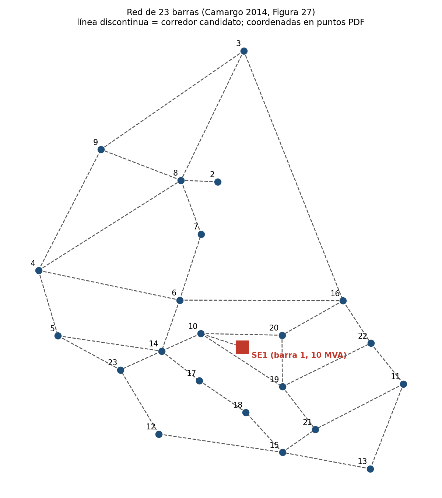
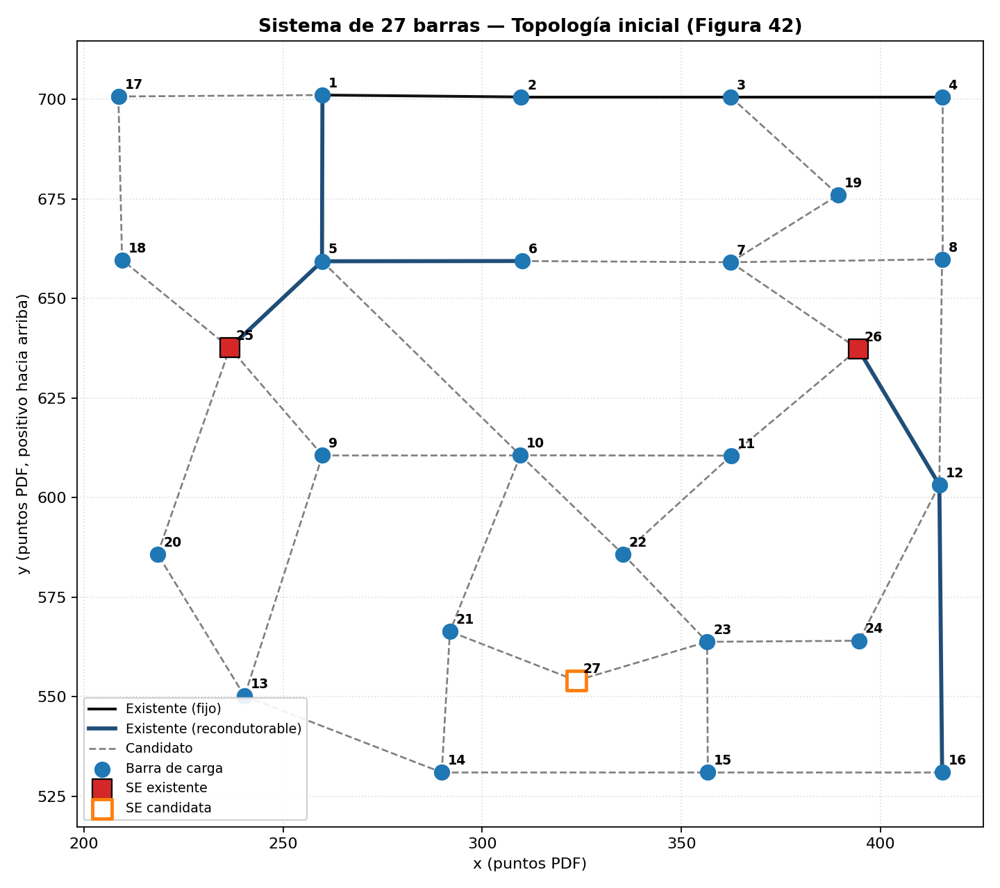
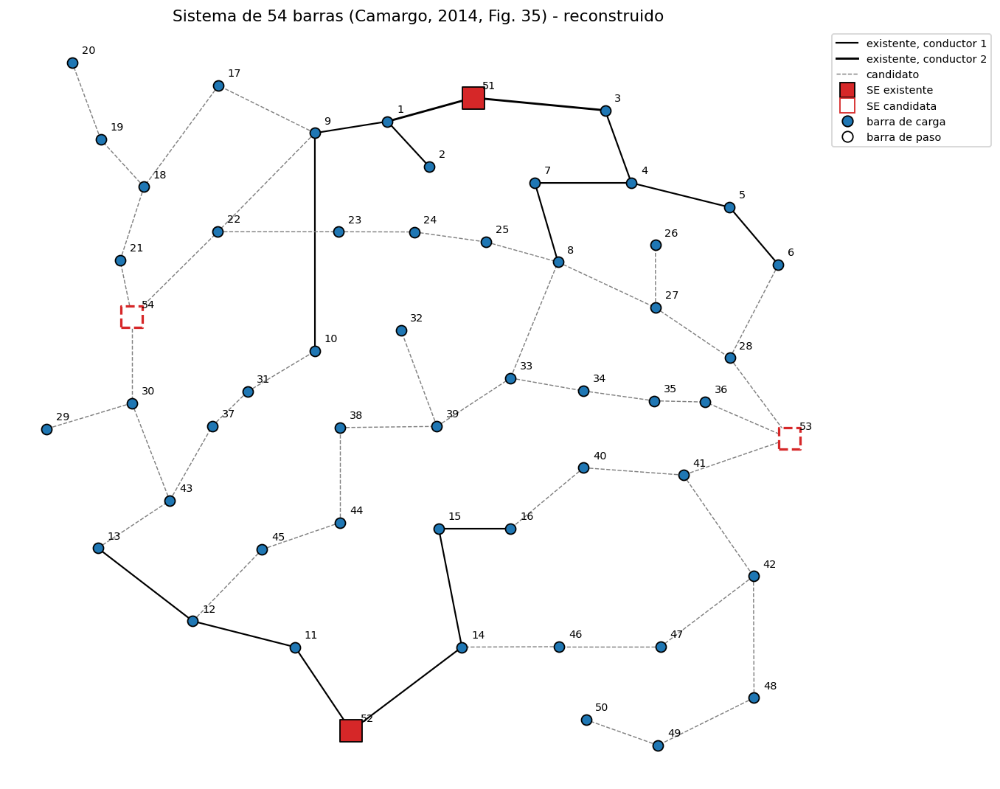
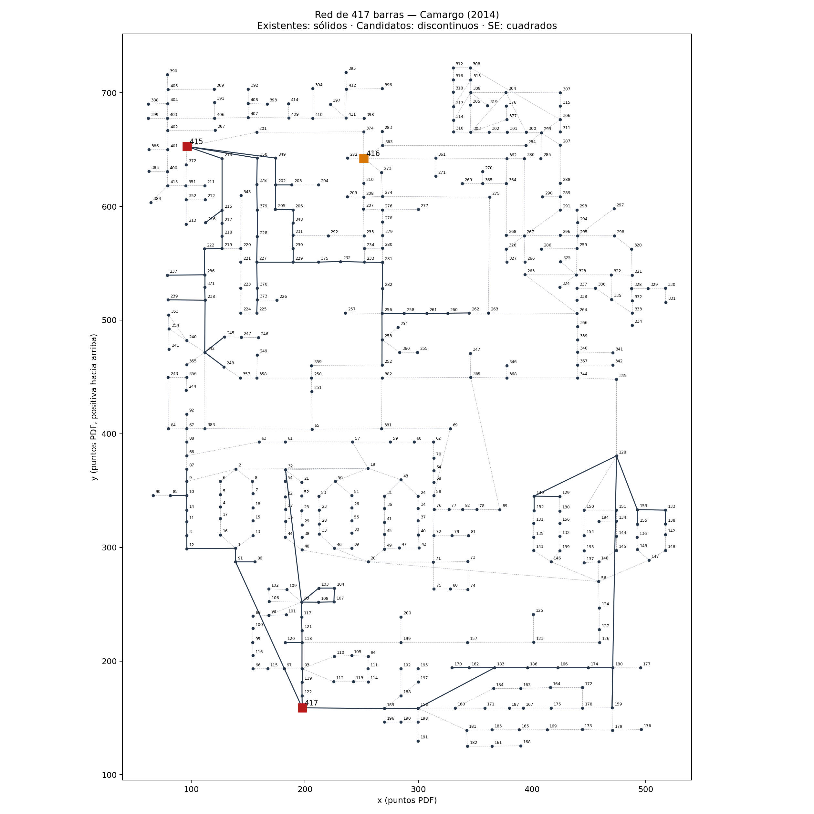
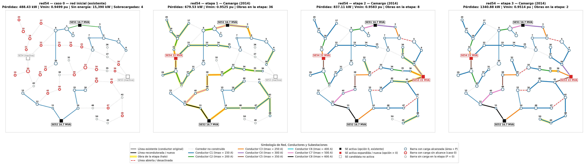

# Redes de prueba para el planeamiento de la expansión de redes de distribución (DNEP)

Base de datos abierta, en formato tabular (CSV + JSON), con **cuatro redes de distribución de prueba**
listas para usarse como entrada de algoritmos de **planeamiento de la expansión de sistemas de
distribución** (*Distribution Network Expansion Planning*, DNEP): construcción y recondutoramiento de
circuitos, ampliación y construcción de subestaciones, planeamiento multietapa, confiabilidad y,
como extensión, incorporación de recursos energéticos distribuidos (DER).

*English summary:* four benchmark distribution systems (23, 27, 54 and 417 buses) for distribution
network expansion planning, digitized from the appendices of Camargo (2014) into a common CSV/JSON
schema, with the published reference solution of each network, ready-to-run OpenDSS models that
reproduce the thesis results, a small Python loader and exports to Excel and SQLite.

---

## ¿Para qué sirve?

Las redes de prueba de planeamiento de distribución suelen estar solo en tablas de tesis y artículos
en PDF, cada una con su propio formato. Este repositorio las reúne en **una estructura común**, para que
cualquier persona pueda:

- usarlas directamente como entrada de modelos de optimización (MILP, metaheurísticas, etc.);
- comparar sus resultados con los publicados: cada red incluye la **solución de referencia** de la tesis
  (qué se construye en cada etapa) y su **modelo OpenDSS validado** contra las pérdidas y tensiones publicadas;
- extenderlas: escenarios de crecimiento de carga, curvas horarias, ubicación de DER, etc.

## Origen de los datos

Todos los datos de red provienen de los anexos de la tesis doctoral:

> CAMARGO, Vera Lúcia Vieira de. **Algoritmo genético especializado aplicado ao planejamento da expansão
> de sistemas de distribuição de energia elétrica.** 2014. 175 f. Tese (Doutorado em Engenharia Elétrica) —
> Faculdade de Engenharia de Ilha Solteira, Universidade Estadual Paulista (UNESP), Ilha Solteira, 2014.
> Orientador: Rubén Augusto Romero Lázaro. Coorientadora: Marina Lavorato de Oliveira.

La tesis, a su vez, recopila sistemas de la literatura (las fuentes originales se indican en cada red).
Los datos se extrajeron por código desde el PDF y se verificaron contra los balances de potencia
publicados en la propia tesis. **Este repositorio no incluye la tesis**; consúltela en el repositorio
institucional de la UNESP.

## Las redes

| Red | Tensión | Barras | Corredores (exist./cand.) | Etapas | Tipo de problema | Fuente original |
|---|---|---|---|---|---|---|
| [`red23`](data/red23/README.md) | 34,5 kV | 23 | 0 / 35 | 1 × 20 años | Estático, red nueva | Oliveira (2010) |
| [`red27`](data/red27/README.md) | 13,8 kV | 27 | 8 / 31 | 3 × 1 año | Multietapa **+ confiabilidad** | Lotero y Contreras (2011) |
| [`red54`](data/red54/README.md) | 15 kV | 54 | 16 / 45 | 3 × 5 años | Multietapa | Miranda et al. (1994), Baquero (2012) |
| [`red417`](data/red417/README.md) | 10 kV | 417 | 88 / 385 | 3 × 5 años | Multietapa, gran escala | Bernal-Agustín (1998), Baquero (2012) |

| red23 | red27 |
|---|---|
|  |  |
| **red54** | **red417** |
|  |  |

Líneas sólidas: circuitos existentes. Líneas discontinuas: corredores candidatos. Cuadrados: subestaciones.

## Solución de referencia y validación en OpenDSS

Para cada red se incluye la solución publicada por Camargo (2014) etapa por etapa
(`data/<red>/solution_camargo/`) y los modelos OpenDSS (`opendss/<red>/`) de dos casos:

- **caso 0 (`base`)**: la red inicial, solo circuitos y subestaciones existentes, con la demanda de cada etapa;
- **`camargo`**: la solución de la tesis en cada etapa.

Simulando la solución en OpenDSS **solo con la tensión de la fuente como ajuste** (sin tocar cargas,
impedancias ni topologías) se reproducen los resultados publicados en las cuatro redes:

| Red | V fuente | Pérdidas: error máx. | Vmin: error máx. | Observación principal |
|---|---|---|---|---|
| red23 | 1,03 pu | 0,01 % | 0,0001 pu | V = límite superior de la red (desvío 3 %) |
| red27 | 1,05 pu (la de la tesis) | 0,28 % | 0,0005 pu | confirma R/X por circuito y fp = 0,9 |
| red54 | 1,00 pu | 0,01 % | 0,0005 pu | la solución **abre 4 líneas** al entrar la SE 53 |
| red417 | 1,00 pu | 0,01 % | 0,0001 pu | la **red inicial tiene 2 lazos**; la solución los abre |

```bash
pip install py-dss-interface        # Windows
python examples/validar_opendss.py  # reproduce la tabla
```



*red54: caso 0 (en rojo, cargas que la red inicial no alcanza) y solución de Camargo en las etapas 1–3.
Color = conductor; halo amarillo = obra de la etapa; rojo discontinuo = línea abierta.
Figuras de todas las redes en [`figuras/solucion_camargo/`](figuras/solucion_camargo/) y en el README de cada red.*

## Estructura del repositorio

```
data/
├── load_curves.csv          curvas de carga estándar de 24 h (res, com, ind)
├── red23/  red27/  red54/  red417/
│   ├── README.md            descripción, supuestos y resultado de referencia de la red
│   ├── system.json          parámetros: tensión, etapas, límites, economía
│   ├── buses.csv            barras: tipo, coordenadas, clase de carga, consumidores
│   ├── loads.csv            demanda pico P, Q por barra y etapa
│   ├── lines.csv            corredores existentes y candidatos, longitud, conductor
│   ├── conductors.csv       catálogo de conductores: R, X, Imax, costo
│   ├── substations.csv      subestaciones existentes/candidatas y sus alternativas
│   ├── (opcionales)         recond_cost.csv, line_costs.csv, consumers.csv, reliability.json
│   └── solution_camargo/    solución publicada: lines.csv, substations.csv, reference.json
opendss/<red>/base|camargo/  modelos OpenDSS por etapa (master_e{s}.dss), listos para abrir en OpenDSS
docs/DICCIONARIO_DATOS.md    descripción de cada archivo y columna
figuras/                     dibujo de cada red; solucion_camargo/: caso 0 + solución por etapa
redes_dnep.py                cargador en Python (solo requiere pandas)
redes_dnep_opendss.py        genera los .dss y corre el flujo de potencia (py-dss-interface)
examples/ejemplo_uso.py      ejemplo completo
examples/validar_opendss.py  reproduce en OpenDSS los resultados de la tesis
```

El detalle de cada columna y unidad está en **[docs/DICCIONARIO_DATOS.md](docs/DICCIONARIO_DATOS.md)**.

## Uso

### Sin programar
Los archivos son CSV: se abren directamente en Excel, LibreOffice, MATLAB (`readtable`), R (`read.csv`)
o cualquier otra herramienta.

### Con Python

```bash
pip install -r requirements.txt
python examples/ejemplo_uso.py
```

```python
import redes_dnep as rd

rd.list_networks()                      # ['red23', 'red27', 'red417', 'red54']
net = rd.load_network("red54")
print(net.summary())

net.buses, net.lines, net.loads         # pandas.DataFrame
net.system["V_kV"]                      # parámetros de system.json
net.peak_loads(stage=2)                 # demanda pico de la etapa 2
net.hourly_loads(stage=2)               # 24 h por barra con las curvas estándar
net.lines_with_impedance()              # R_ohm, X_ohm de cada corredor (conductor instalado)
net.lines_with_impedance(conductor=3)   # ... o evaluando todos con el conductor 3

lines, subs = net.topology(stage=2, case="camargo")  # solución de la tesis en la etapa 2
lines, subs = net.topology(case="base")              # caso 0: red inicial
net.solution["reference"]                            # pérdidas, Vmin y SE publicadas
```

### Flujo de potencia en OpenDSS

Sin programar: abra `opendss/<red>/<caso>/master_e{s}.dss` en OpenDSS (la tensión de la fuente viene en
1,0 pu; la que reproduce la tesis está en `reference.json`). Desde Python:

```python
import redes_dnep_opendss as rdo

r = rdo.simulate("red54", case="camargo", stage=3)     # usa la tensión ajustada por defecto
r["losses_kW"], r["vmin_pu"], r["sources"], r["overloaded_lines"]
r = rdo.simulate("red54", case="base", stage=3, v_source_pu=1.0)
r["unserved_loads"]                                     # cargas que la red inicial no alcanza
```

Punto de partida para estudios con DER: los `.dss` generados se pueden extender con `PVSystem`,
`Storage` o `Generator` en las barras `b<número>`.

### Como base de datos (SQLite o Excel)

```python
rd.export_sqlite("redes.sqlite")          # todas las redes; cada tabla con columna `network`
rd.export_excel("red27", "red27.xlsx")    # una hoja por tabla (requiere openpyxl)
```

```sql
-- demanda total por red y etapa
SELECT network, stage, SUM(P_kW)/1000 AS P_MW FROM loads GROUP BY network, stage;
```

## Supuestos y limitaciones (léase antes de usar)

- **Curvas de carga:** la tesis solo da la demanda pico. `data/load_curves.csv` contiene curvas **típicas
  elegidas para este conjunto de datos** (no provienen de la tesis); se pueden reemplazar.
- **Clase de carga y número de consumidores:** solo `red27` trae consumidores en la fuente. En las demás,
  `load_class` y `n_consumers` se estimaron con una regla fija (ver el diccionario de datos).
- **Coordenadas:** están en puntos de la figura del PDF; sirven para dibujar, no para medir distancias.
  En `red417` el reconocimiento de etiquetas se confirmó para el 84 % de los segmentos dibujados.
- **red27:** sin longitudes en la fuente; se usa un modelo por circuito (`length_km = 1`) y fp = 0,9
  (supuestos confirmados al reproducir la tesis en OpenDSS).
- **Reconfiguración:** las soluciones de la tesis **abren circuitos** (red54 y red417). La red inicial de
  `red417` no es radial (2 lazos). Un modelo de planeamiento debe permitir abrir líneas existentes para
  reproducir estas soluciones.
- **red54:** la demanda disminuye entre etapas en las barras 4, 9, 24 y 49 (así viene en la tesis).
- **Modelo eléctrico de validación:** trifásico balanceado, SE como fuentes rígidas, cargas de potencia
  constante en el pico de cada etapa, sin capacitancia de línea.
- **red54 y red417:** la tesis no informa el costo de la energía (`energy_cost_per_kWh = null`).
- Los costos están en la moneda original de cada red (US$ o R$) y no se convirtieron entre sí.

Los detalles de cada red están en su `README.md`.

## Cómo citar

Si usa estos datos, cite la tesis de origen (arriba) y las fuentes originales de cada red.
Ver también [`CITATION.cff`](CITATION.cff).

## Licencia

*Pendiente de definir por el autor del repositorio.* Los datos derivan de trabajos académicos
publicados; se recomienda citar siempre la fuente original.
