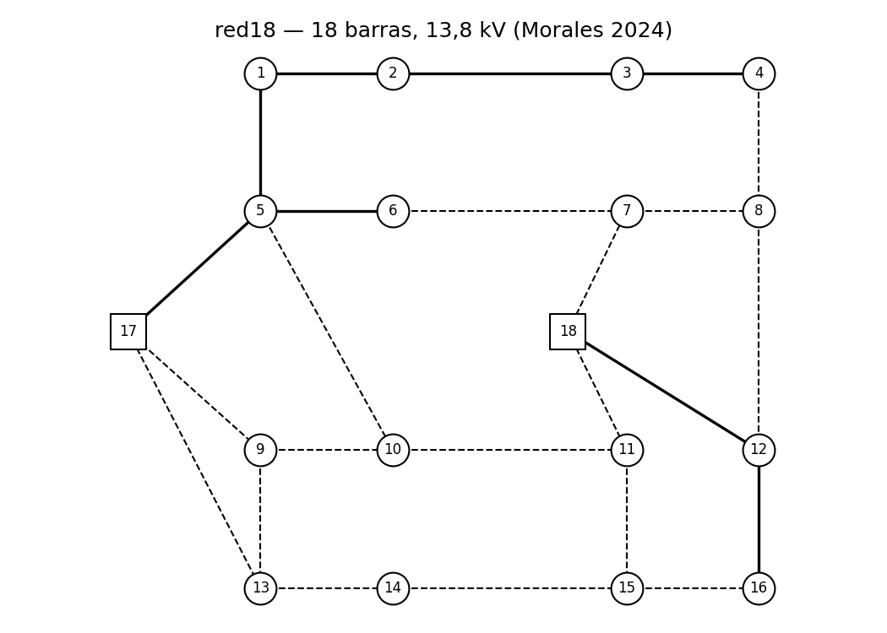
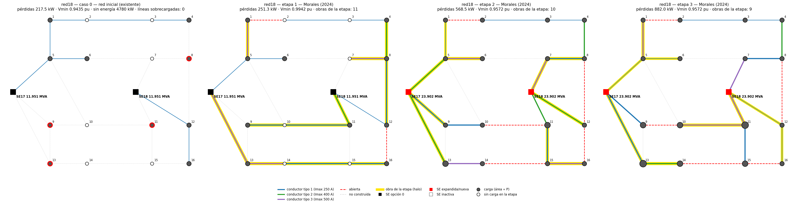

# red18 — Sistema de 18 barras, 13,8 kV (con consumidores industriales)

**Problema:** planeamiento **multietapa** (3 etapas de 1, 1 y 2 años) con costo de pérdidas, pérdidas
financieras por huecos de tensión e interrupciones, y confiabilidad individual de consumidores Industria 4.0.

**Origen:** Morales (2024), Sec. 6.1, Fig. 15–16 y Apéndice A (Tabelas 26–27). Sistema de la literatura
(Haffner et al.), usado también por Cebrian, Milanović y Kagan (2014).

| Elemento | Valor |
|---|---|
| Barras | 18: 16 de carga, SE existentes 17 y 18 |
| Corredores | 8 existentes (5 admiten recondutoramiento) y 16 candidatos, 3 tipos de conductor |
| Conductores | tipo 1: 250 A / 1,0 Ω; tipo 2: 400 A / 0,7 Ω; tipo 3: 500 A / 0,5 Ω (por circuito) |
| Demanda | en corriente: 500 / 900 / 1 200 A → 11,95 / 21,51 / 28,68 MW |
| Capacidad de SE | 500 A cada una en la etapa 1, 1000 A en las etapas 2–3 |
| Consumidores | 83 residenciales, 4 comerciales, 4 industriales |
| Límites de tensión | 0,95–1,05 pu |
| Economía | 0,1 US$/kWh (8760 h sobre la pérdida pico), interés 10 % a.a., remoción = 30 % del costo de instalación |

## Supuestos importantes
- **Demandas en corriente:** `P = √3 · 13,8 kV · I`, `Q = 0` (fp = 1; la red es puramente resistiva, el fp no
  cambia corrientes ni pérdidas). La corriente original es `I = P_kW / (√3 · 13,8)`.
- **Modelo de carga: corriente constante** (`system.json: load_model`). Es el único que reproduce la tesis.
- **Impedancia por circuito:** la fuente da Z (Ω) sin separar R y X → `R = Z`, `X = 0`, `length_km = 1`;
  costos por circuito en `line_costs.csv` (US$).
- `years_per_stage` es una lista `[1, 1, 2]` (las etapas no duran lo mismo); `pv_factor_by_stage` = 1 / 0,9091 / 0,8264.
- La ampliación de SE de 500 a 1000 A en la etapa 2 es un **dato**, no una decisión: opción 1 con costo 0.
- Barras 2, 3, 7, 10, 14 y 15: la tesis no da su número de consumidores; `n_consumers = 1` (mínimo del esquema).
- La confiabilidad (FEC/DEC máximos, FIC/DIC por barra industrial, costos por evento) está en la tesis
  (Tabelas 5, 28 y 29) pero sin tasas de falla por circuito: no se incluye `reliability.json`.

## Solución de referencia y validación en OpenDSS

Primer panel: **caso 0** (red inicial; en rojo las cargas que no alcanza). Siguientes: solución de Morales (2024),
cenário 4 (Tabela 18), por etapa.

La tesis publica el **costo** de pérdidas por etapa (221,42 / 455,46 / 642,39 kUS$), del que se derivan
252,76 / 571,92 / 887,37 kW. Simulada en OpenDSS ([`opendss/red18/`](../../opendss/red18/)):

| Etapa | Pérdidas OpenDSS (kW) | Derivadas de la tesis (kW) | Error | Vmin OpenDSS (1,03 pu) |
|---|---|---|---|---|
| 1 | 251.25 | 252.76 | -0.60 % | 0.9942 |
| 2 | 568.50 | 571.92 | -0.60 % | 0.9572 |
| 3 | 882.00 | 887.37 | -0.61 % | 0.9572 |

Observaciones:

- El error es **−0,60 % idéntico en las tres etapas**: un factor de conversión constante de la tesis
  (≈ 881,3 US$/kW·año en lugar de 8760 × 0,1 = 876), no una diferencia de datos.
- **La tesis no informa la tensión de la fuente.** Con cargas de corriente constante las pérdidas no dependen
  de ella; la solución publicada cumple 0,95–1,05 pu solo con V entre **1,023 y 1,05 pu**. Se adopta 1,03 pu.
  A 1,00 pu las etapas 2–3 quedarían en 0,927 pu.
- La Fig. 21 de la tesis (etapa 1) no dibuja la línea 7-8, que sí está en la Tabela 18; con ella el costo de
  inversión de la etapa 1 da 1 651 US$ = 1,65k publicado.
- **Reconfiguración:** la solución abre la línea existente 1-2 en las tres etapas y la 12-16 en las etapas 1–2,
  y cambia conductores entre etapas, también hacia uno menor (7-8: tipo 3 → 1).
- En la etapa 3 la línea 17-13 opera exactamente a su capacidad (250 A).
