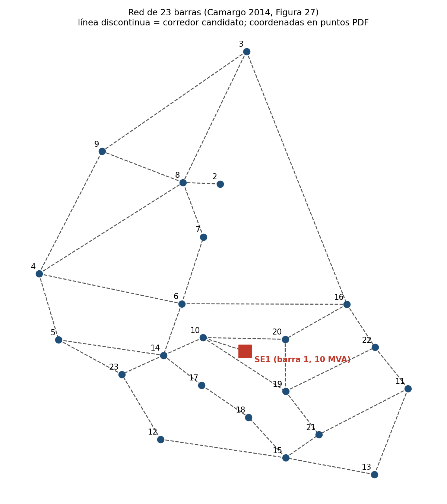

# red23 — Sistema de 23 barras, 34,5 kV

**Problema:** planeamiento **estático** (una etapa, horizonte de 20 años) partiendo de cero: hay una
subestación y todas las rutas son candidatas. Es el caso más simple; útil para depurar algoritmos.

**Origen:** Camargo (2014), Sección 6.1.1 (Teste 1), Anexo A (Tablas 27–30), Figura 27.
Sistema original de Oliveira (2010); usado también por Gomez et al. (2004), Nahman y Peric (2008) y Souza (2011).

| Elemento | Valor |
|---|---|
| Barras | 23: 21 de carga, 1 subestación (barra 1, 10 MVA, sin ampliación), 1 de paso (barra 2) |
| Corredores | 35 candidatos (36,15 km), ninguno existente |
| Conductores | 2 tipos: 1 (1/0 AWG) y 4 (4/0 AWG) |
| Demanda | 7 040 kVA → P = 6,34 MW, Q = 3,07 Mvar |
| Límites de tensión | 0,97–1,03 pu (desvío máx. 3 %) |
| Economía | 0,05 US$/kWh, factor de pérdidas 0,35, interés 10 % a.a. |

## Supuestos
- La tesis da solo la potencia aparente S; P y Q se obtuvieron con **fp = 0,9** (valor indicado en la tesis).
- `load_class` y `n_consumers` **no están en la tesis**: todas las barras se clasificaron `res`
  y los consumidores se estimaron como S / 5 kVA.
- Se incluye solo el **Teste 1**. El Teste 2 de la tesis (SE de 4 MVA en la barra 1 y SE candidata de
  4 MVA en la barra 2, US$ 1 000 000) no está en estos archivos.

## Resultado de referencia (Camargo 2014, Teste 1)
Costo total 171 353 US$ (circuitos 151 136 + pérdidas 20 217); pérdidas 15,49 kW; tensión mínima 1,024 pu;
todos los circuitos con conductor tipo 1.
