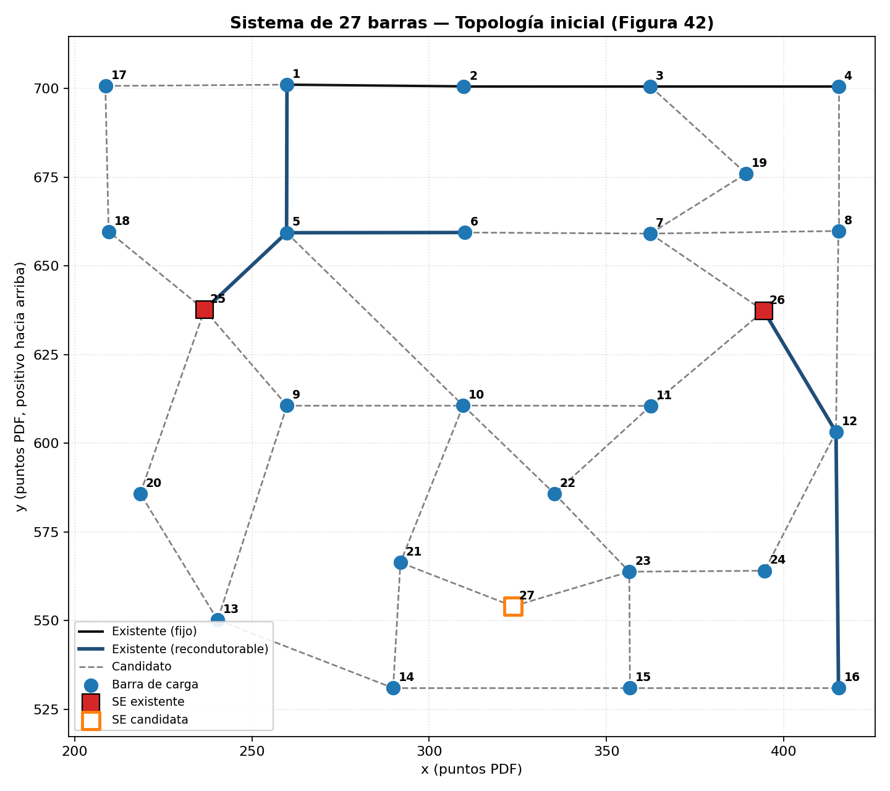

# red27 — Sistema de 27 barras, 13,8 kV (con confiabilidad)

**Problema:** planeamiento **multietapa** (3 etapas de 1 año) con **restricciones de confiabilidad**
(DIC, FIC, DEC, FEC). Es la única red con número de consumidores por etapa y datos de confiabilidad.

**Origen:** Camargo (2014), Secciones 6.3.1 y 6.3.1.2, Anexo E (Tablas 49–53), Figura 42.
Sistema adaptado por Lotero y Contreras (2011) a partir de Haffner et al. (2008).

| Elemento | Valor |
|---|---|
| Barras | 27: 24 de carga, SE existentes 25 y 26 (15 MVA, ampliables a 22,5 o 27 MVA), SE candidata 27 (7,5 o 12 MVA) |
| Corredores | 8 existentes (5 admiten recondutoramiento a tipos 2 y 3) y 31 candidatos (tipos 1 y 2) |
| Conductores | 3 tipos |
| Demanda S por etapa | 13,2 / 20,4 / 37,2 MVA |
| Consumidores por etapa | 510 / 690 / 900 |
| Límites de tensión | 0,95–1,05 pu; tensión en la SE fijada en 1,05 pu |
| Economía | 0,10 US$/kWh, operación de SE 1·10⁻⁸ US$/kVA²h, factor de pérdidas 0,35, interés 10 % a.a. |
| Confiabilidad | 0,4 fallas/año por circuito, reparación 2 h, reconfiguración 0,25 h; DIC ≤ 4 h, FIC ≤ 4, DEC ≤ 2 h, FEC ≤ 2 |

## Supuestos importantes
- **La tesis no da longitudes de los circuitos** y los costos son **por circuito**. Convención adoptada:
  `length_km = 1.0` en todos los corredores; R y X de `conductors.csv` se interpretan como **Ω por circuito**;
  los costos están en `line_costs.csv` y `conductors.cost_per_km = 0.0` (`line_model = per_circuit`).
  Esta interpretación de R y X no está confirmada por la fuente: conviene validarla con un flujo de carga
  contra las pérdidas de referencia de abajo.
- **La tesis no da el factor de potencia:** P y Q se obtuvieron de S con **fp = 0,9 (supuesto)**.
- `load_class` no está en la tesis: todas las barras se clasificaron `com` (S pico ≥ 1000 kVA).

## Resultado de referencia (Camargo 2014, Caso I, sin restricciones de confiabilidad)
Valor presente total 3 190,87 ×10³ US$; ampliación de la SE 25 en la etapa 3; pérdidas por etapa
184 / 387 / 1134 kW; tensión mínima 1,007 / 0,992 / 0,963 pu.
