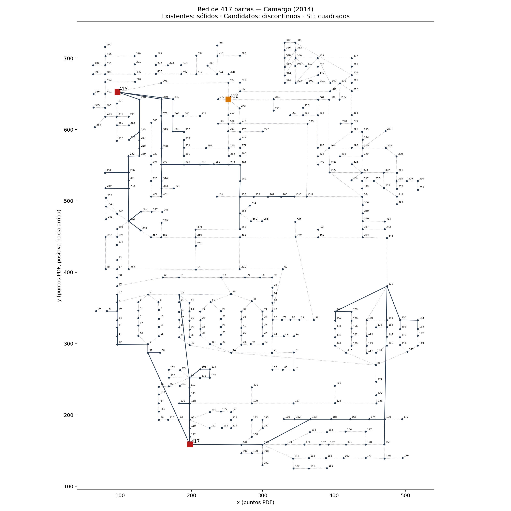

# red417 — Sistema de 417 barras, 10 kV

**Problema:** planeamiento **multietapa** (3 etapas de 5 años) a escala realista. Útil para evaluar
la escalabilidad de los algoritmos.

**Origen:** Camargo (2014), Secciones 6.2 y 6.2.2, Anexo D (Tablas 43–48), Figura 39.
Sistema propuesto por Bernal-Agustín (1998) y usado por Baquero (2012).

| Elemento | Valor |
|---|---|
| Barras | 417: 311 de carga, 103 de paso, SE existentes 415 y 417 (40 MVA, sin ampliación), SE candidata 416 (8 o 40 MVA) |
| Corredores | 88 existentes y 385 candidatos (110,87 km en total) |
| Conductores | 4 tipos, con matriz de costos de recondutoramiento (`recond_cost.csv`) |
| Demanda P / Q por etapa | 16,42 / 21,89 / 27,36 MW — 7,94 / 10,59 / 13,24 Mvar |
| Límites de tensión | 0,95–1,00 pu |
| Economía | factor de pérdidas 0,25, interés 10 % a.a.; **la tesis no informa el costo de la energía** (`null`) |

## Supuestos y limitaciones
- **Coordenadas:** en la figura de la tesis los números de barra están dibujados como trazos (no texto);
  se reconocieron por su forma. Las 417 coordenadas vienen de la figura, pero solo el **84 %** de los
  segmentos dibujados se pudo confirmar contra la tabla de circuitos. Sirven para dibujar; no se
  recomiendan para cálculos geométricos (usar `length_km`).
- P y Q vienen de la tesis (no se usó factor de potencia).
- `load_class` y `n_consumers` no están en la tesis: todas las barras de carga son `res`;
  consumidores estimados como S / 5 kVA.

## Resultado de referencia (Camargo 2014, AG-ESP)
Valor presente total 4 060,29 ×10³ R$ (el mejor resultado de la literatura citado en la tesis es 4,35 % menor);
construcción de la SE 416 en la etapa 1; pérdidas por etapa 250,22 / 460,68 / 688,44 kW;
tensión mínima 0,964 / 0,953 / 0,950 pu.
