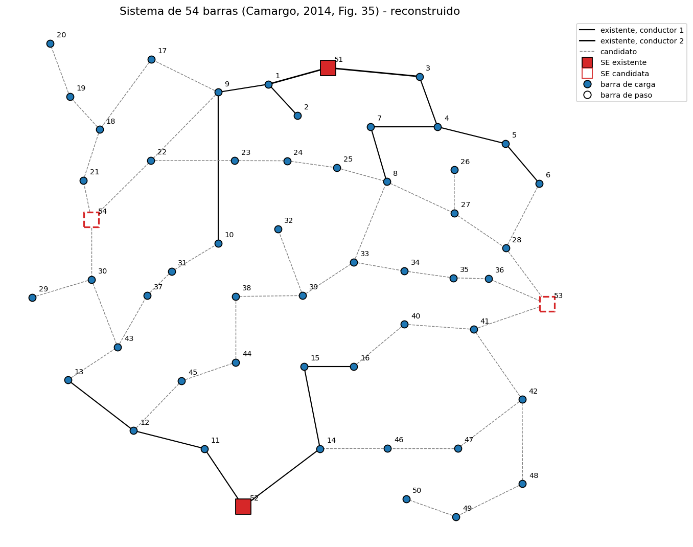
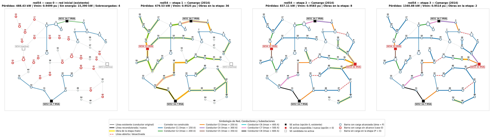

# red54 — Sistema de 54 barras, 15 kV

**Problema:** planeamiento **multietapa** (3 etapas de 5 años) con todas las decisiones típicas:
construir circuitos, recondutorar (8 conductores), ampliar subestaciones existentes y construir nuevas.
Tamaño intermedio, adecuado para comparar algoritmos.

**Origen:** Camargo (2014), Secciones 6.2 y 6.2.1, Anexo C (Tablas 37–42), Figura 35.
Sistema propuesto por Miranda, Ranito y Proença (1994) y adaptado por Baquero (2012).

| Elemento | Valor |
|---|---|
| Barras | 54: 50 de carga; SE existentes 51 y 52 (16,7 MVA, ampliables a 33,4); SE candidatas 53 y 54 (22 o 30 MVA) |
| Corredores | 16 existentes y 45 candidatos (97,04 km en total) |
| Conductores | 8 tipos, con matriz de costos de recondutoramiento (`recond_cost.csv`) |
| Demanda P / Q por etapa | 33,03 / 46,98 / 59,31 MW — 18,35 / 26,10 / 32,95 Mvar |
| Límites de tensión | 0,95–1,00 pu |
| Economía | factor de pérdidas 0,25, interés 10 % a.a.; **la tesis no informa el costo de la energía** (`null`) |

## Supuestos
- P y Q vienen de la tesis (no se usó factor de potencia).
- Algunas barras tienen demanda 0 en las primeras etapas y se activan después (26, 27, 32, 35, 38, 42, 43, 46, 49, 50).
- `load_class` y `n_consumers` no están en la tesis: `com` si S pico ≥ 1000 kVA, si no `res`;
  consumidores estimados como S / 5 kVA (res) o S / 25 kVA (com).
- Los costos de recondutoramiento se interpretan como costo por km.

## Resultado de referencia (Camargo 2014, AG-ESP)
Valor presente total 7 191,11 ×10³ R$ (Baquero 2012: 7 228,00 ×10³ R$); construcción de la SE 54
en la etapa 1 y de la SE 53 en la etapa 2; pérdidas por etapa 679,53 / 837,10 / 1340,88 kW;
tensión mínima 0,952 / 0,958 / 0,951 pu.

## Solución de referencia y validación en OpenDSS

Primer panel: **caso 0** (red inicial; en rojo las cargas que no alcanza). Siguientes: solución de Camargo por etapa (color = conductor, halo amarillo = obra de la etapa, rojo discontinuo = línea abierta).

La solución está en [`solution_camargo/`](solution_camargo/) (Camargo (2014), Sec. 6.2.1, Tablas 6 y 7). Simulada en OpenDSS ([`opendss/red54/`](../../opendss/red54/)) con tensión de fuente **1.00 pu**, sin modificar cargas ni impedancias:

| Etapa | Pérdidas OpenDSS (kW) | Tesis (kW) | Vmin OpenDSS (pu) | Tesis (pu) |
|---|---|---|---|---|
| 1 | 679.53 | 679.53 | 0.9525 | 0.952 |
| 2 | 837.11 | 837.1 | 0.9583 | 0.958 |
| 3 | 1340.88 | 1340.88 | 0.9514 | 0.951 |

Observaciones:

- **Reconfiguración:** al entrar la SE 53 (etapa 2) la solución **abre 4 líneas** (L5, L13, L45, L59) y transfiere esas cargas. Un modelo que no permita abrir circuitos no puede reproducir esta solución.
- **Demanda decreciente** entre etapas en las barras 4, 9, 24 y 49 (así viene en la tesis).
- Caso 0: la red inicial deja 24 barras (15,4 MW) sin alimentación en la etapa 1 y sobrecarga 4 líneas.
